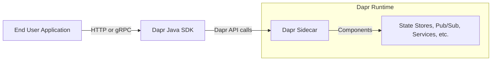
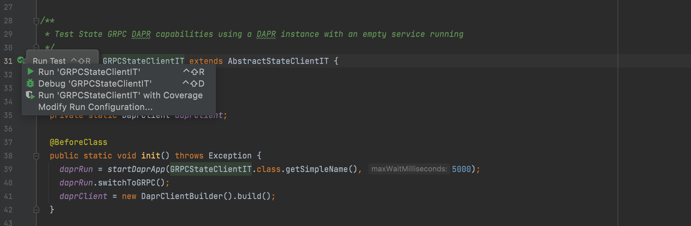

# Dapr SDK for Java

[](https://central.sonatype.com/artifact/io.dapr/dapr-sdk) [](https://github.com/dapr/java-sdk/actions/workflows/build.yml) [](https://codecov.io/gh/dapr/java-sdk) [](https://github.com/dapr/java-sdk/blob/master/LICENSE) [](https://app.fossa.com/projects/custom%2B162%2Fgithub.com%2Fdapr%2Fjava-sdk?ref=badge_shield) [](https://github.com/dapr/java-sdk/issues?q=is%3Aissue+is%3Aopen+label%3A%22good+first+issue%22) [](http://bit.ly/dapr-discord) [](https://youtube.com/@daprdev) [](https://twitter.com/daprdev)

The Java SDK for [Dapr](https://dapr.io): durable workflows, actors, pub/sub, state, service invocation, bindings and Spring Boot integration.

* **Docs:** [Java SDK documentation](https://docs.dapr.io/developing-applications/sdks/java/)
* **API reference:** [Javadoc](https://dapr.github.io/java-sdk/)

## Workflows

Write durable workflows in plain Java with `dapr-sdk-workflows`. Workflow state is persisted by Dapr, so a workflow picks up where it left off after a crash or restart.

* [Workflow overview](https://docs.dapr.io/developing-applications/building-blocks/workflow/workflow-overview/)
* [Java SDK documentation](https://docs.dapr.io/developing-applications/sdks/java/)
* [Workflow examples](./examples/src/main/java/io/dapr/examples/workflows/)

## Getting Started

### Architecture Overview

The diagram below shows how a Java application interacts with the Dapr runtime through the Java SDK:



For the full list of available APIs, see the [Dapr API reference](https://docs.dapr.io/reference/api/)

### Pre-Requisites
* JDK 17 or later
* [Maven 3.x](https://maven.apache.org/install.html) or [Gradle](https://gradle.org/install/)
* An existing Java Maven or Gradle project. To start a new one, see [Maven in 5 minutes](https://maven.apache.org/guides/getting-started/maven-in-five-minutes.html).
* The [Dapr CLI](https://docs.dapr.io/getting-started/install-dapr-cli/), to run your application with a Dapr sidecar locally

IDE setup and the tools needed to work on the SDK itself are under [Development](#development).

### Importing Dapr's Java SDK

> **Spring Boot compatibility:** from **1.19.0** onward, the SDK's Spring integration targets **Spring Boot 4.0**. If you are on **Spring Boot 3.5**, use the **1.18.x** line instead. See **[SUPPORT.md](SUPPORT.md)** for the full compatibility matrix and version-support policy.

#### Using a BOM (recommended)

Two BOMs are published:

> Upgrading workflow code from a release that still had `durabletask-client`? See
> [MIGRATION.md](MIGRATION.md).

- **`io.dapr:dapr-sdk-bom`** — core SDK modules (`dapr-sdk`, `dapr-sdk-actors`, `dapr-sdk-workflows`, `dapr-sdk-autogen`, `testcontainers-dapr`) plus security-patched transitive dependencies (Netty, Jackson, commons-compress, commons-codec).
- **`io.dapr.spring:dapr-spring-bom`** — Spring-specific modules (`dapr-sdk-springboot`, `dapr-spring-*`). Imports `dapr-sdk-bom` transitively, so Spring users only need this single BOM.

`durabletask-client` is the gRPC client and worker for the Durable Task engine that runs Dapr workflows; `dapr-sdk-workflows` pulls it in, so you do not add it yourself.

Pick the one that matches your project. Importing a BOM ensures you inherit security fixes for transitive dependencies like the Netty CVEs. With a BOM imported, the version is set once on the BOM and left off each Dapr dependency.

##### Core (non-Spring) projects

For Maven:
```xml
<project>
  ...
  <dependencyManagement>
    <dependencies>
      <dependency>
        <groupId>io.dapr</groupId>
        <artifactId>dapr-sdk-bom</artifactId>
        <version>1.19.0</version>
        <type>pom</type>
        <scope>import</scope>
      </dependency>
    </dependencies>
  </dependencyManagement>

  <dependencies>
    <!-- Dapr's core SDK with all features, except Actors and Workflows. -->
    <dependency>
      <groupId>io.dapr</groupId>
      <artifactId>dapr-sdk</artifactId>
    </dependency>
    <!-- Dapr's SDK for Workflows (optional). -->
    <dependency>
      <groupId>io.dapr</groupId>
      <artifactId>dapr-sdk-workflows</artifactId>
    </dependency>
    <!-- Dapr's SDK for Actors (optional). -->
    <dependency>
      <groupId>io.dapr</groupId>
      <artifactId>dapr-sdk-actors</artifactId>
    </dependency>
    ...
  </dependencies>
  ...
</project>
```

For Gradle:
```groovy
dependencies {
    implementation platform('io.dapr:dapr-sdk-bom:1.19.0')

    // Dapr's core SDK with all features, except Actors and Workflows.
    implementation 'io.dapr:dapr-sdk'
    // Dapr's SDK for Workflows (optional).
    implementation 'io.dapr:dapr-sdk-workflows'
    // Dapr's SDK for Actors (optional).
    implementation 'io.dapr:dapr-sdk-actors'
}
```

##### Spring Boot projects

For Maven:
```xml
<project>
  ...
  <dependencyManagement>
    <dependencies>
      <dependency>
        <groupId>io.dapr.spring</groupId>
        <artifactId>dapr-spring-bom</artifactId>
        <version>1.19.0</version>
        <type>pom</type>
        <scope>import</scope>
      </dependency>
    </dependencies>
  </dependencyManagement>

  <dependencies>
    <!-- Dapr's SDK integration with Spring Boot. -->
    <dependency>
      <groupId>io.dapr</groupId>
      <artifactId>dapr-sdk-springboot</artifactId>
    </dependency>
    <!-- Optional Spring Boot starter. -->
    <dependency>
      <groupId>io.dapr.spring</groupId>
      <artifactId>dapr-spring-boot-starter</artifactId>
    </dependency>
  </dependencies>
  ...
</project>
```

For Gradle:
```groovy
dependencies {
    implementation platform('io.dapr.spring:dapr-spring-bom:1.19.0')

    // Dapr's SDK integration with Spring Boot.
    implementation 'io.dapr:dapr-sdk-springboot'
    // Optional Spring Boot starter.
    implementation 'io.dapr.spring:dapr-spring-boot-starter'
}
```

#### Without the BOM

If you prefer to manage versions manually, specify the version on each dependency:

For Maven:
```xml
<project>
  ...
  <dependencies>
    <dependency>
      <groupId>io.dapr</groupId>
      <artifactId>dapr-sdk</artifactId>
      <version>1.19.0</version>
    </dependency>
    <dependency>
      <groupId>io.dapr</groupId>
      <artifactId>dapr-sdk-actors</artifactId>
      <version>1.19.0</version>
    </dependency>
    <dependency>
      <groupId>io.dapr</groupId>
      <artifactId>dapr-sdk-springboot</artifactId>
      <version>1.19.0</version>
    </dependency>
  </dependencies>
  ...
</project>
```

For Gradle:
```groovy
dependencies {
    def daprVersion = '1.19.0'

    implementation "io.dapr:dapr-sdk:${daprVersion}"
    implementation "io.dapr:dapr-sdk-actors:${daprVersion}"
    implementation "io.dapr:dapr-sdk-springboot:${daprVersion}"
}
```

### Running the examples
Clone this repository including the submodules:

```sh
git clone https://github.com/dapr/java-sdk.git
```

Then head over to build the [Maven](https://maven.apache.org/install.html) (Apache Maven version 3.x) project:

```sh
# make sure you are in the `java-sdk` directory.
./mvnw clean install
```

Try the following examples to learn more about Dapr's Java SDK:
* [Invoking a Http service](./examples/src/main/java/io/dapr/examples/invoke/http)
* [Invoking a Grpc service](./examples/src/main/java/io/dapr/examples/invoke/grpc)
* [State management](./examples/src/main/java/io/dapr/examples/state)
* [PubSub with subscriber](./examples/src/main/java/io/dapr/examples/pubsub/)
* [PubSub with streaming subscription](./examples/src/main/java/io/dapr/examples/pubsub/stream/)
* [Binding with input over Http](./examples/src/main/java/io/dapr/examples/bindings/http)
* [Actors](./examples/src/main/java/io/dapr/examples/actors/)
* [Workflows](./examples/src/main/java/io/dapr/examples/workflows/)
* [Secrets management](./examples/src/main/java/io/dapr/examples/secrets)
* [Configuration](./examples/src/main/java/io/dapr/examples/configuration)
* [Distributed tracing with OpenTelemetry SDK](./examples/src/main/java/io/dapr/examples/tracing)
* [Exception handling](./examples/src/main/java/io/dapr/examples/exception)
* [Unit testing](./examples/src/main/java/io/dapr/examples/unittesting)

### Running Spring Boot examples

The Spring Boot integration for Dapr use [Testcontainers](https://testcontainers.com) to set up a local environment development flow that doesn't 
require the use of the `dapr` CLI and it integrates with the Spring Boot programming model. 

You can find a [step-by-step tutorial showing this integration here](./spring-boot-examples/README.md).

### API Documentation

See the [Javadoc](https://dapr.github.io/java-sdk/) for the API reference, and the [Java SDK documentation](https://docs.dapr.io/developing-applications/sdks/java/) for guides.

### Reactor API

The Java SDK for Dapr is built using [Project Reactor](https://projectreactor.io/). It provides an asynchronous API for Java. A result is consumed synchronously by using the `block()` method, as shown in the examples referenced above.

The code below does not make any API call, it simply returns the [Mono](https://projectreactor.io/docs/core/release/api/reactor/core/publisher/Mono.html) publisher object. Nothing happens until the application subscribes or blocks on the result:

```java
Mono<Void> result = daprClient.publishEvent("mytopic", "my message");
```

To start execution and receive the result object synchronously (`void` or `Void` becomes an empty result), use `block()`. The code below shows how to execute the call and consume an empty response:
```java
Mono<Void> result = daprClient.publishEvent("mytopic", "my message");
result.block();
```

### How to use a custom serializer

This SDK provides a basic serialization for request/response objects, and state objects. Applications should provide their own serialization for production scenarios.

1. Implement the [DaprObjectSerializer](https://dapr.github.io/java-sdk/io/dapr/serializer/DaprObjectSerializer.html) interface. See [this class](sdk-actors/src/test/java/io/dapr/actors/runtime/JavaSerializer.java) as an example.
2. Use your serializer class in the following scenarios:
    * When building a new instance of [DaprClient](https://dapr.github.io/java-sdk/io/dapr/client/DaprClient.html):
    ```java
    DaprClient client = (new DaprClientBuilder())
        .withObjectSerializer(new MyObjectSerializer()) // for request/response objects.
        .withStateSerializer(new MyStateSerializer()) // for state objects.
        .build();
    ```
    * When registering an Actor Type:
    ```java
    ActorRuntime.getInstance().registerActor(
      DemoActorImpl.class,
      new MyObjectSerializer(), // for request/response objects.
      new MyStateSerializer()); // for state objects.
    ```
    * When building a new instance of [ActorProxy](https://dapr.github.io/java-sdk/io/dapr/actors/client/ActorProxy.html) to invoke an Actor instance, use the same serializer as when registering the Actor Type:
    ```java
    try (ActorClient actorClient = new ActorClient()) {
      DemoActor actor = (new ActorProxyBuilder(DemoActor.class, actorClient))
          .withObjectSerializer(new MyObjectSerializer()) // for request/response objects.
          .build(new ActorId("100"));
    }
    ```


### Debug a Java application or Dapr's Java SDK

**In IntelliJ Community Edition, consider [debugging in IntelliJ](https://docs.dapr.io/developing-applications/local-development/ides/intellij/).**

**In Visual Studio Code, consider [debugging in Visual Studio Code](https://docs.dapr.io/developing-applications/local-development/ides/vscode/).**

If you need to debug your Application, run the Dapr sidecar separately, and then start the application from your IDE (IntelliJ or Eclipse, for example).
For Linux and MacOS:

```sh
dapr run --app-id testapp --app-port 3000 --dapr-http-port 3500 --dapr-grpc-port 5001
```

> Note: confirm the correct port that the app will listen to and that the Dapr ports above are free, changing the ports if necessary.

When running your Java application from your IDE, make sure the following environment variables are set, so the Java SDK knows how to connect to Dapr's sidecar:
```
DAPR_HTTP_PORT=3500
DAPR_GRPC_PORT=5001
```

Now you can go to your IDE and debug your Java application, using port `3500` to call Dapr while also listening to port `3000` to expose Dapr's callback endpoint.

### Exception handling

Most exceptions thrown from the SDK are instances of `DaprException`. `DaprException` extends from `RuntimeException`, making it compatible with Project Reactor. See the [exception example](./examples/src/main/java/io/dapr/examples/exception) for more details.

## Development

### Tools

* JDK 17. With [SDKMAN!](https://sdkman.io), run `sdk env install` in the repo root to install the JDK pinned in `.sdkmanrc`.
* Maven is not needed: use the wrapper, `./mvnw`.
* A Java IDE, for example [IntelliJ](https://www.jetbrains.com/idea/download/), [Eclipse](https://www.eclipse.org/downloads/), [Apache NetBeans](https://netbeans.apache.org/download/index.html) or [Visual Studio Code](https://code.visualstudio.com/Download), with Maven support if it needs a plugin:
    * [Maven in IntelliJ](https://www.jetbrains.com/help/idea/maven.html)
    * [Maven in Eclipse with m2e](https://projects.eclipse.org/projects/technology.m2e)

### Update URL to fetch proto files

Change the `dapr.proto.baseurl` property below in [pom.xml](./pom.xml) to point to the URL for the desired commit hash in Git if you need to target a proto file that is not been merged into master yet. 

Note: You may need to run `./mvnw clean` after changing this setting to remove any auto-generated files so that the new proto files get downloaded and compiled.

```xml
<project>
  ...
  <properties>
    ...
    <!-- change this .... -->
    <dapr.proto.baseurl>https://raw.githubusercontent.com/dapr/dapr/(current ref in pom.xml)/dapr/proto</dapr.proto.baseurl>
    <!-- to something like this: -->
    <dapr.proto.baseurl>https://raw.githubusercontent.com/dapr/dapr/1ac5d0e8590a7d6772c9957c236351ed992ccb19/dapr/proto</dapr.proto.baseurl>
    ...
  </properties>
  ...
</project>
```

### Running Integration Tests (ITs)

#### Pre-Requisites
* The [development tools](#tools)
* Docker installed and running
  * [Docker Desktop](https://www.docker.com/products/docker-desktop)
* Bash shell
  * In Windows use [WSL2](https://docs.microsoft.com/en-us/windows/wsl/install)
  * In Linux and Mac, default shells are enough

#### Code

The code for the tests are present inside the project [sdk-tests](./sdk-tests). This module alone can be imported as a separate project in IDEs. 
This project depends on the rest of the JARs built by the other modules in the repo like [sdk](./sdk), [sdk-springboot](./sdk-springboot) etc.

As a starting point for running the Integration Tests, first run `./mvnw clean install` from the root of the repo to build the JARs for the different modules, except the `sdk-tests` module.

#### Backing services (managed automatically by Testcontainers)

The integration tests use [Testcontainers](https://testcontainers.com/) to start and manage every backing service they depend on — Redis, Zipkin, MongoDB, Kafka, [Toxiproxy](https://github.com/Shopify/toxiproxy) for the resiliency tests, and the Dapr control plane (`placement` and `scheduler`) — automatically at test runtime.

There is no separate step to bring these services up: you only need a running Docker daemon. Testcontainers pulls the required images and starts/stops the containers as the tests run.


#### Run all ITs from command line
From the `java-sdk` repo root, change to the `sdk-tests` directory and run the following command.

```bash
## with current directory as /java-sdk/sdk-tests/

../mvnw clean install
```

The above command runs all the integration tests present in the `sdk-tests` project. 

#### Run Individual tests from IntelliJ

In IntelliJ, go to `File > New > Project from Existing Sources...`. Import the `sdk-tests` project. 

Once the project has been imported, the individual tests can be run normally as any Unit Tests, from the IDE itself.

.

> Sometimes when the `sdk-tests` project does not build correctly, try `File > Invalidate Caches...`  and try restarting IntelliJ.

You should be able to set breakpoints and Debug the test directly from IntelliJ itself as seen from the above image. 