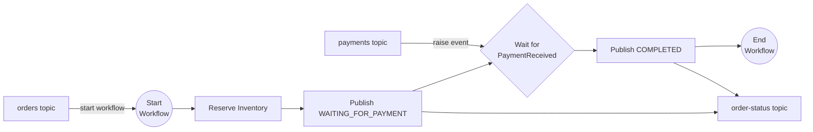

# Dapr Spring Boot Event Driven Workflow Example

This application shows how to combine [Dapr Workflows](https://docs.dapr.io/developing-applications/building-blocks/workflow/workflow-overview/) 
with [Dapr Pub/Sub](https://docs.dapr.io/developing-applications/building-blocks/pubsub/pubsub-overview/) in a Spring Boot 
application:

- An `orders` event starts a new workflow instance.
- The workflow waits for a `payments` event, which is forwarded to it as an external event.
- The workflow publishes its progress to the `order-status` topic from an activity.



The main classes are:

- [`OrderEventsSubscriber`](src/main/java/io/dapr/springboot/examples/eventworkflow/OrderEventsSubscriber.java): 
  subscribes to the topics using the `@Topic` annotation. It starts the workflow with `DaprWorkflowClient.scheduleNewWorkflow`, 
  using the order id as the workflow instance id, and forwards payments with `DaprWorkflowClient.raiseEvent`.
- [`OrderProcessingWorkflow`](src/main/java/io/dapr/springboot/examples/eventworkflow/OrderProcessingWorkflow.java): 
  waits for the `PaymentReceived` external event. If the payment does not arrive within 5 minutes, the order is cancelled.
- [`PublishOrderStatusActivity`](src/main/java/io/dapr/springboot/examples/eventworkflow/PublishOrderStatusActivity.java): 
  publishes the status events using `DaprMessagingTemplate`. Publishing happens in an activity because workflow code 
  is replayed and must not perform I/O directly.

## Running this example from source code

To run this example you will need:
- Java SDK
- Maven
- Docker or a container runtime such as Podman

From the `spring-boot-examples/workflows/event-workflow` directory you can start the service by running the following command:

<!-- STEP
name: Run Event Workflow Application
match_order: none
output_match_mode: substring
expected_stdout_lines:
- 'Started EventWorkflowApplication'
background: true
expected_return_code: 143
sleep: 60
timeout_seconds: 240
-->
<!-- Timeout for above service must be more than sleep + timeout for the client-->

```sh
../../../mvnw spring-boot:test-run
```

<!-- END_STEP -->

By running the `spring-boot:test-run` goal, the application is loaded using the [test configurations](src/test/java/io/dapr/springboot/examples/eventworkflow/DaprTestContainersConfig.java)
configured using [Testcontainers](https://testcontainers.com) to bootstrap the [Dapr](https://dapr.io) sidecar, 
PostgreSQL (used as the workflow state store) and RabbitMQ (used as the Pub/Sub broker).

## Placing an order

Publish an order event by sending a POST request to the application:

<!-- STEP
name: Place an order
match_order: none
output_match_mode: substring
expected_stdout_lines:
- 'Order Event Published: order-1'
timeout_seconds: 90
-->
<!-- Timeout for above service must be more than sleep + timeout for the client-->

```sh
curl -X POST localhost:8080/orders -H 'Content-Type: application/json' -d '{ "id": "order-1", "item": "the mars volta EP", "amount": 1 }' --retry 10 --max-time 20 --retry-all-errors --retry-max-time 90
```

<!-- END_STEP -->

The subscriber of the `orders` topic starts a workflow instance. The workflow reserves the inventory and publishes 
the `WAITING_FOR_PAYMENT` status. You can check the last status received from the `order-status` topic:

<!-- STEP
name: Check order is waiting for payment
match_order: none
output_match_mode: substring
expected_stdout_lines:
- '"status":"WAITING_FOR_PAYMENT"'
timeout_seconds: 90
-->
<!-- Timeout for above service must be more than sleep + timeout for the client-->

```sh
curl --fail localhost:8080/orders/order-1/status --retry 10 --max-time 20 --retry-all-errors --retry-max-time 90
```

<!-- END_STEP -->

```bash
{"orderId":"order-1","status":"WAITING_FOR_PAYMENT"}
```

In the application output you should see:

```bash
i.d.s.e.e.OrdersRestController           : Publishing Order Event: Order{id='order-1', item='the mars volta EP', amount=1}
i.d.s.e.e.OrderEventsSubscriber          : Order Event Received: Order{id='order-1', item='the mars volta EP', amount=1}
i.d.s.e.e.OrderEventsSubscriber          : Workflow instance order-1 started
i.d.s.e.e.OrderProcessingWorkflow        : Starting Workflow: io.dapr.springboot.examples.eventworkflow.OrderProcessingWorkflow
i.d.s.e.e.ReserveInventoryActivity       : Reserving 1 unit(s) of 'the mars volta EP' for order order-1
i.d.s.e.e.PublishOrderStatusActivity     : Publishing Order Status Event: OrderStatus{orderId='order-1', status='WAITING_FOR_PAYMENT'}
i.d.s.e.e.OrderEventsSubscriber          : Order Status Event Received: OrderStatus{orderId='order-1', status='WAITING_FOR_PAYMENT'}
```

## Paying for the order

Publish a payment event for the order:

<!-- STEP
name: Pay the order
match_order: none
output_match_mode: substring
expected_stdout_lines:
- 'Payment Event Published: order-1'
sleep: 10
timeout_seconds: 90
-->
<!-- Timeout for above service must be more than sleep + timeout for the client-->

```sh
curl -X POST localhost:8080/orders/order-1/payment -H 'Content-Type: application/json' -d '{ "total": 10.0 }' --retry 10 --max-time 20 --retry-all-errors --retry-max-time 90
```

<!-- END_STEP -->

The subscriber of the `payments` topic raises the `PaymentReceived` event on the workflow instance `order-1`, and the 
workflow completes the order:

<!-- STEP
name: Check order is completed
match_order: none
output_match_mode: substring
expected_stdout_lines:
- '"status":"COMPLETED"'
timeout_seconds: 90
-->
<!-- Timeout for above service must be more than sleep + timeout for the client-->

```sh
curl --fail localhost:8080/orders/order-1/status --retry 10 --max-time 20 --retry-all-errors --retry-max-time 90
```

<!-- END_STEP -->

```bash
{"orderId":"order-1","status":"COMPLETED"}
```

In the application output you should see:

```bash
i.d.s.e.e.OrderEventsSubscriber          : Payment Event Received: Payment{orderId='order-1', total=10.0}
i.d.s.e.e.OrderProcessingWorkflow        : Payment received for order order-1: Payment{orderId='order-1', total=10.0}
i.d.s.e.e.PublishOrderStatusActivity     : Publishing Order Status Event: OrderStatus{orderId='order-1', status='COMPLETED'}
i.d.s.e.e.OrderEventsSubscriber          : Order Status Event Received: OrderStatus{orderId='order-1', status='COMPLETED'}
```

## Testing event driven workflows

The [`EventWorkflowAppIT`](src/test/java/io/dapr/springboot/examples/eventworkflow/EventWorkflowAppIT.java) test uses 
Testcontainers to run the same flow end to end: it places an order, waits for the `WAITING_FOR_PAYMENT` status, 
pays the order and checks that the workflow instance completed.
