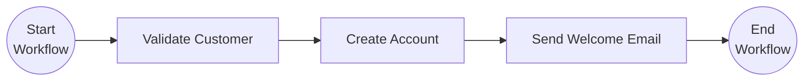

# Dapr Spring Boot Simple Workflow Example

This application is the starting point for using [Dapr Workflows](https://docs.dapr.io/developing-applications/building-blocks/workflow/workflow-overview/) 
with Spring Boot. It onboards a customer in three steps:



It shows how to:

- Define a workflow ([`CustomerOnboardingWorkflow`](src/main/java/io/dapr/springboot/examples/simpleworkflow/CustomerOnboardingWorkflow.java)) 
  and its activities as Spring `@Component`s, and register them with `@EnableDaprWorkflows`.
- Inject regular Spring beans into activities, like the [`AccountService`](src/main/java/io/dapr/springboot/examples/simpleworkflow/AccountService.java) 
  used by `CreateAccountActivity`.
- Start a workflow from a REST endpoint with `DaprWorkflowClient.scheduleNewWorkflow` without waiting for it to finish, 
  and check its status and result later with `DaprWorkflowClient.getWorkflowState`.
- See a workflow fail when one of its activities throws an exception.

For more workflow patterns, such as fan out/fan in, timers, child workflows or external events, see the 
[workflow patterns example](../patterns/README.md).

## Running this example from source code

To run this example you will need:
- Java SDK
- Maven
- Docker or a container runtime such as Podman

From the `spring-boot-examples/workflows/simple-workflow` directory you can start the service by running the following command:

<!-- STEP
name: Run Simple Workflow Application
match_order: none
output_match_mode: substring
expected_stdout_lines:
- 'Started SimpleWorkflowApplication'
background: true
expected_return_code: 143
timeout_seconds: 180
-->
<!-- Timeout for above service must be more than sleep + timeout for the client-->

```sh
../../../mvnw spring-boot:test-run
```

<!-- END_STEP -->

By running the `spring-boot:test-run` goal, the application is loaded using the [test configurations](src/test/java/io/dapr/springboot/examples/simpleworkflow/DaprTestContainersConfig.java)
configured using [Testcontainers](https://testcontainers.com) to bootstrap the [Dapr](https://dapr.io) sidecar and 
control plane. No Dapr components are configured, so the workflow state is kept in an in-memory state store.

## Onboarding a customer

Start the workflow by sending a POST request with the customer. The customer id is used as the workflow instance id, 
and the request returns as soon as the workflow is scheduled:

<!-- STEP
name: Start onboarding workflow
match_order: none
output_match_mode: substring
expected_stdout_lines:
- 'customer-1'
sleep: 5
timeout_seconds: 90
-->
<!-- Timeout for above service must be more than sleep + timeout for the client-->

```sh
curl -X POST localhost:8080/onboarding -H 'Content-Type: application/json' -d '{ "id": "customer-1", "name": "Ada Lovelace", "email": "ada@example.com" }' --retry 10 --max-time 20 --retry-all-errors --retry-max-time 90
```

<!-- END_STEP -->

Then check the status of the workflow instance:

<!-- STEP
name: Check onboarding workflow
match_order: none
output_match_mode: substring
expected_stdout_lines:
- '"runtimeStatus":"COMPLETED"'
- '"accountId":"account-customer-1"'
timeout_seconds: 90
-->
<!-- Timeout for above service must be more than sleep + timeout for the client-->

```sh
curl --fail localhost:8080/onboarding/customer-1 --retry 10 --max-time 20 --retry-all-errors --retry-max-time 90
```

<!-- END_STEP -->

```bash
{"error":null,"instanceId":"customer-1","result":{"accountId":"account-customer-1","customerId":"customer-1","welcomeEmailSent":true},"runtimeStatus":"COMPLETED"}
```

In the application output you should see the activities being executed:

```bash
i.d.s.e.s.OnboardingRestController       : Workflow instance customer-1 started
i.d.s.e.s.CustomerOnboardingWorkflow     : Starting Workflow: io.dapr.springboot.examples.simpleworkflow.CustomerOnboardingWorkflow
i.d.s.e.s.ValidateCustomerActivity       : Customer customer-1 is valid
i.d.s.e.s.CreateAccountActivity          : Account account-customer-1 created for customer customer-1
i.d.s.e.s.SendWelcomeEmailActivity       : Sending welcome email to ada@example.com
i.d.s.e.s.CustomerOnboardingWorkflow     : Workflow finished with result: OnboardingResult{customerId='customer-1', accountId='account-customer-1', welcomeEmailSent=true}
```

## A failing workflow

If an activity throws an exception and the workflow does not catch it, the workflow instance fails. Start the 
onboarding for a customer without an email:

<!-- STEP
name: Start onboarding workflow for invalid customer
match_order: none
output_match_mode: substring
expected_stdout_lines:
- 'customer-2'
sleep: 5
timeout_seconds: 90
-->
<!-- Timeout for above service must be more than sleep + timeout for the client-->

```sh
curl -X POST localhost:8080/onboarding -H 'Content-Type: application/json' -d '{ "id": "customer-2", "name": "No Email" }' --retry 10 --max-time 20 --retry-all-errors --retry-max-time 90
```

<!-- END_STEP -->

The status shows that the workflow failed, and why:

<!-- STEP
name: Check failed onboarding workflow
match_order: none
output_match_mode: substring
expected_stdout_lines:
- '"runtimeStatus":"FAILED"'
- 'Invalid email for customer customer-2'
timeout_seconds: 90
-->
<!-- Timeout for above service must be more than sleep + timeout for the client-->

```sh
curl --fail localhost:8080/onboarding/customer-2 --retry 10 --max-time 20 --retry-all-errors --retry-max-time 90
```

<!-- END_STEP -->

## Testing workflows

The [`SimpleWorkflowAppIT`](src/test/java/io/dapr/springboot/examples/simpleworkflow/SimpleWorkflowAppIT.java) test 
uses Testcontainers to run both scenarios end to end.
